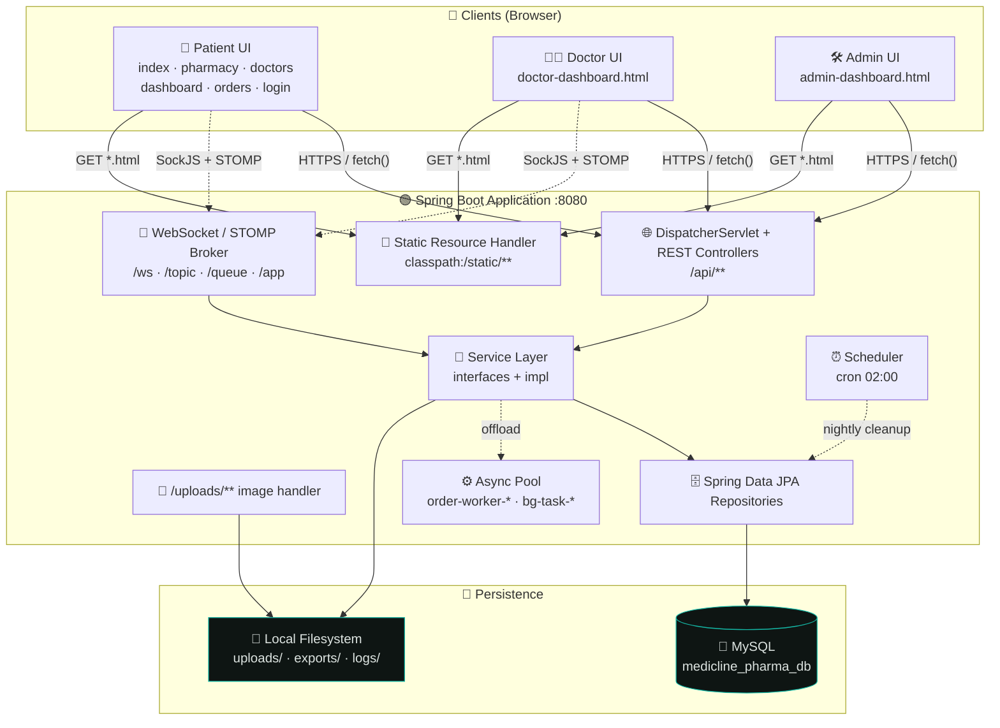
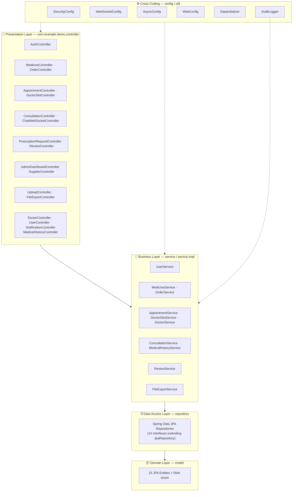
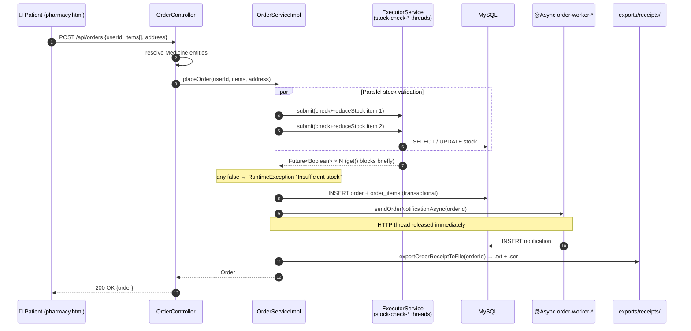
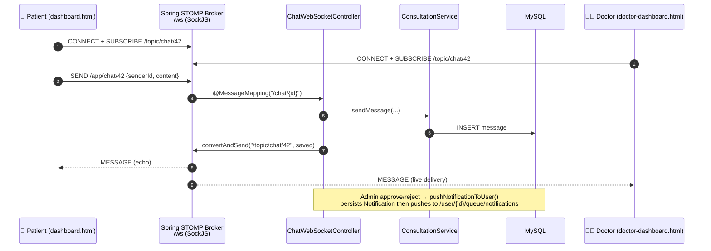
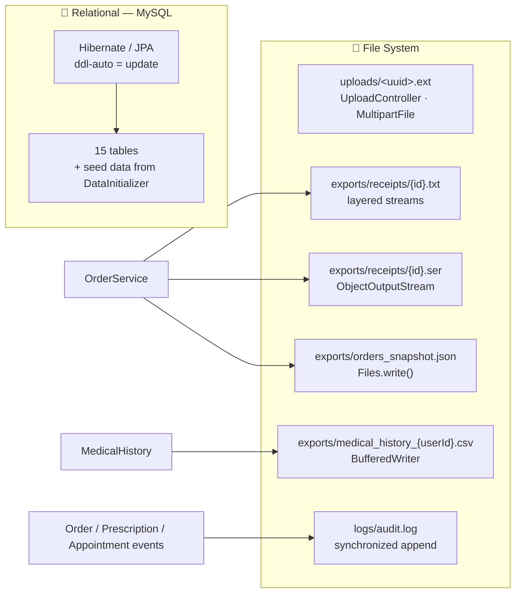
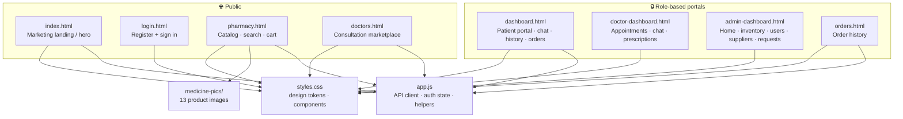

# 🏥 Medicline Pharma

**Precision Care, Redefined.** — A full-stack digital pharmacy, doctor-consultation and prescription-management platform built with **Spring Boot 4**, **Spring Data JPA**, **WebSocket/STOMP** and a hand-crafted, glassmorphic dark-mode front end.

<p>
  
  
  
  
  
</p>

---

## 📖 Table of Contents

| # | Section |
|---|---------|
| 1 | [Overview](#-overview) |
| 2 | [Feature Matrix](#-feature-matrix) |
| 3 | [Tech Stack](#-tech-stack) |
| 4 | [System Architecture](#-system-architecture) |
| 5 | [Layered Architecture](#-layered-architecture) |
| 6 | [Request Lifecycle](#-request-lifecycle) |
| 7 | [Real-Time Layer (WebSocket)](#-real-time-layer-websocket) |
| 8 | [Concurrency & Async Model](#-concurrency--async-model) |
| 9 | [Domain Model (ER Diagram)](#-domain-model-er-diagram) |
| 10 | [Persistence & File I/O](#-persistence--file-io) |
| 11 | [REST API Reference](#-rest-api-reference) |
| 12 | [Frontend & Design System](#-frontend--design-system) |
| 13 | [Project Structure](#-project-structure) |
| 14 | [Getting Started](#-getting-started) |
| 15 | [Default Credentials](#-default-credentials) |
| 16 | [Configuration](#-configuration) |
| 17 | [Roadmap & Known Limitations](#-roadmap--known-limitations) |

---

## 🎯 Overview

Medicline Pharma unifies **three portals** into a single Spring Boot application that serves both the REST API and the static single-page UI:

- 🛒 **Pharmacy Storefront** — browse a seeded catalog of 50+ real medicines across 13 therapeutic categories, add to cart and place orders.
- 🩺 **Doctor Consultations** — book appointment slots, chat in real time, receive digital prescriptions and build a medical history.
- 🛠️ **Admin Console** — manage inventory stock, suppliers, prescription approval requests, users and platform-wide statistics.

The interface follows a **Glassmorphic-Cybernetic** design language: deep charcoal surfaces (`#0E1513`), a teal signal color (`#14B8A6`), layered translucency, luminous glows and pulse "live" indicators.

> **Note on naming:** this project was previously developed under the working names *E-Medicine* / *Suno Health* / *AuraHealth Precision*. All user-facing branding, Maven coordinates, application name and database name have been unified to **Medicline Pharma** (see `pom.xml`, `application.properties`, `DESIGN.md`, `skill.md`).

---

## ✨ Feature Matrix

| Capability | Patient | Doctor | Admin |
|---|:---:|:---:|:---:|
| Register / login (role-based) | ✅ | ✅ | ✅ |
| Browse & search pharmacy catalog | ✅ | – | ✅ |
| Cart & place order | ✅ | – | – |
| Order history & receipts | ✅ | – | ✅ |
| Request a prescription-protected medicine (with image upload) | ✅ | – | – |
| Approve / reject prescription requests | – | – | ✅ |
| View available doctor slots & book appointment | ✅ | – | – |
| Approve / reject / complete appointments | – | ✅ | – |
| Real-time consultation chat | ✅ | ✅ | – |
| Issue digital prescription & medical history | – | ✅ | – |
| Post-visit doctor review & rating | ✅ | – | – |
| Inventory stock management | – | – | ✅ |
| Supplier management | – | – | ✅ |
| User administration | – | – | ✅ |
| Platform statistics dashboard | – | – | ✅ |
| Notifications (persisted + live push) | ✅ | ✅ | ✅ |
| CSV / JSON / TXT / `.ser` data export | – | – | ✅ |

---

## 🧰 Tech Stack

| Layer | Technology |
|---|---|
| **Language** | Java 17 |
| **Framework** | Spring Boot 4.0.6 (`webmvc`, `data-jpa`, `security`, `websocket`) |
| **Persistence** | MySQL 8 + Hibernate/JPA (`ddl-auto=update`) |
| **Real-time** | STOMP over WebSocket with SockJS fallback, in-memory simple broker |
| **Concurrency** | `ThreadPoolTaskExecutor`, `@Async`, `@Scheduled`, `ExecutorService` + `Future` |
| **File I/O** | `java.nio.file`, layered streams, Java serialization (`.ser`), CSV/JSON/TXT writers |
| **Frontend** | Vanilla HTML5 / CSS3 / ES6 modules-free JS (no build step) |
| **Styling** | Custom design-token CSS, Inter + Playfair Display, glassmorphism, CSS animations |
| **Tooling** | Maven Wrapper (`mvnw`), Lombok |

---

## 🏗 System Architecture

High-level view of how users, browser assets, the Spring container and external systems fit together:



---

## 🧱 Layered Architecture

Classic **Controller → Service → Repository → Entity** layering, with cross-cutting config and utility packages:



---

## 🔄 Request Lifecycle

Example: **a patient places an order** — showing the parallel stock checks, synchronous persistence and fire-and-forget post-processing:



---

## 🔌 Real-Time Layer (WebSocket)

Chat and notifications use a **persistent, bi-directional** WebSocket connection instead of REST polling.



| Destination | Type | Purpose |
|---|---|---|
| `/ws` | Handshake | SockJS + STOMP connect endpoint (all origins allowed in dev) |
| `/app/chat/{consultationId}` | Inbound | Client → server chat messages |
| `/topic/chat/{consultationId}` | Broadcast | Consultation room fan-out (doctor + patient) |
| `/user/{userId}/queue/notifications` | Point-to-point | Private per-user notification push |

---

## ⚙️ Concurrency & Async Model

The project deliberately demonstrates several Java concurrency patterns:

```mermaid
flowchart LR
    subgraph HTTP["HTTP Request Threads"]
        T1["http-nio-8080-exec-*"]
    end

    subgraph Custom["Custom ExecutorService"]
        F["stock-check-* <br/>fixed pool = CPU cores<br/>(daemon threads)"]
    end

    subgraph Spring["Spring ThreadPoolTaskExecutor"]
        O["order-worker-*<br/>core 4 · max 8 · queue 100"]
        B["bg-task-*<br/>core 2 · max 4 · queue 50"]
    end

    subgraph Sched["@Scheduled"]
        S["Daily 02:00 cleanup"]
    end

    T1 -- "submit() per order item" --> F
    F -- "Future&lt;Boolean&gt;" --> T1
    T1 -- "@Async(\"orderExecutor\")" --> O
    T1 -. "@Async(\"taskExecutor\")" .-> B
    S -- "delete read notifications &gt; 30 days" --> DB[("MySQL")]

    classDef pool fill:#161d1b,stroke:#14b8a6,color:#dde4e1;
    class F,O,B,S pool;
```

| Mechanism | Where | Purpose |
|---|---|---|
| `Executors.newFixedThreadPool` + `Future` | `OrderServiceImpl` | Validate/deduct stock for all order items in parallel |
| `@Async("orderExecutor")` | `OrderServiceImpl.sendOrderNotificationAsync` | Persist order notification without blocking the response |
| `ThreadPoolTaskExecutor` beans | `AsyncConfig` | Named, bounded pools (`order-worker-*`, `bg-task-*`) with graceful shutdown |
| `@Scheduled(cron = "0 0 2 * * *")` | `OrderServiceImpl.cleanupOldNotifications` | Nightly purge of read notifications older than 30 days |
| `synchronized` write | `AuditLogger.appendLine` | Prevent interleaved log lines from concurrent threads |

---

## 🗺 Domain Model (ER Diagram)

```mermaid
erDiagram
    USER ||--o| DOCTOR : "profile"
    USER ||--o{ APPOINTMENT : "books (patient)"
    USER ||--o{ CONSULTATION : "starts (patient)"
    USER ||--o{ MESSAGE : "sends"
    USER ||--o{ ORDER : "places"
    USER ||--o{ NOTIFICATION : "receives"
    USER ||--o{ MEDICALHISTORY : "owns (patient)"
    USER ||--o{ REVIEW : "writes (patient)"
    USER ||--o{ PRESCRIPTIONREQUEST : "requests"

    DOCTOR ||--o{ DOCTORSLOT : "offers"
    DOCTOR ||--o{ APPOINTMENT : "attends"
    DOCTOR ||--o{ CONSULTATION : "runs"
    DOCTOR ||--o{ PRESCRIPTION : "issues"
    DOCTOR ||--o{ MEDICALHISTORY : "records"
    DOCTOR ||--o{ REVIEW : "is rated in"

    CONSULTATION ||--o{ MESSAGE : "contains"
    CONSULTATION ||--o| PRESCRIPTION : "produces"
    CONSULTATION ||--o| MEDICALHISTORY : "documents"
    CONSULTATION ||--o| REVIEW : "is reviewed by"

    ORDER ||--o{ ORDERITEM : "contains"
    MEDICINE ||--o{ ORDERITEM : "appears in"
    MEDICINE ||--o{ PRESCRIPTIONREQUEST : "is requested"

    USER {
        Long id PK
        String name
        String email UK
        String password
        Role role "PATIENT|DOCTOR|ADMIN"
    }
    DOCTOR {
        Long id PK
        Long user_id FK
        String specialization
        int experience
        String bio
        String imageUrl
    }
    DOCTORSLOT {
        Long id PK
        Long doctor_id FK
        LocalDate date
        LocalTime startTime
        LocalTime endTime
        boolean isBooked
    }
    APPOINTMENT {
        Long id PK
        Long patient_id FK
        Long doctor_id FK
        LocalDate appointmentDate
        LocalTime startTime
        LocalTime endTime
        String reason
        String status "PENDING|APPROVED|REJECTED|COMPLETED"
        LocalDateTime createdAt
    }
    CONSULTATION {
        Long id PK
        Long patient_id FK
        Long doctor_id FK
        String status "OPEN|CLOSED"
        LocalDateTime timestamp
    }
    MESSAGE {
        Long id PK
        Long consultation_id FK
        Long sender_id FK
        String content
        String imageUrl
        LocalDateTime timestamp
    }
    PRESCRIPTION {
        Long id PK
        Long consultation_id FK
        Long doctor_id FK
        String content
        LocalDateTime date
    }
    MEDICALHISTORY {
        Long id PK
        Long patient_id FK
        Long doctor_id FK
        Long consultation_id FK
        String diagnosis
        String prescription
        String notes
        LocalDateTime visitDate
    }
    REVIEW {
        Long id PK
        Long patient_id FK
        Long doctor_id FK
        Long consultation_id FK
        int rating
        String comment
        LocalDateTime createdAt
    }
    NOTIFICATION {
        Long id PK
        Long user_id FK
        String message
        boolean isRead
        LocalDateTime createdAt
    }
    MEDICINE {
        Long id PK
        String name
        double price
        int stock
        String category
        String imageUrl
        String description
    }
    ORDER {
        Long id PK
        Long user_id FK
        String status "PENDING|APPROVED|SHIPPED|DELIVERED"
        double totalPrice
        String deliveryAddress
        LocalDateTime timestamp
    }
    ORDERITEM {
        Long id PK
        Long order_id FK
        Long medicine_id FK
        int quantity
        double price
    }
    PRESCRIPTIONREQUEST {
        Long id PK
        Long user_id FK
        Long medicine_id FK
        String patientNote
        String prescriptionImageUrl
        String status "PENDING|APPROVED|REJECTED"
        String adminNote
        LocalDateTime createdAt
        LocalDateTime updatedAt
    }
    SUPPLIER {
        Long id PK
        String name
        String contactPerson
        String email
        String phone
        String address
    }
```



---

## 💾 Persistence & File I/O

Two persistence styles are demonstrated side by side: **relational** (JPA/MySQL) and **file-system** (NIO).



| File | Written by | Technique |
|---|---|---|
| `exports/receipts/{orderId}.txt` | `FileExportService` | `FileOutputStream → BufferedOutputStream → PrintWriter` (decorator chain) |
| `exports/receipts/{orderId}.ser` | `FileExportService` | Java serialization via `ObjectOutputStream` |
| `exports/medical_history_{userId}.csv` | `FileExportService` | `Files.newBufferedWriter` with RFC-style quoting |
| `exports/orders_snapshot.json` | `FileExportService` | Manual JSON string built then `Files.write()` |
| `uploads/{uuid}.ext` | `UploadController` | `MultipartFile` → `Files.write` (served via `/uploads/**`) |
| `logs/audit.log` | `AuditLogger` | `synchronized` append-mode writer with thread name in each line |

---

## 🔌 REST API Reference

All endpoints are served under `/api`. Login/registration is handled by `AuthController`; there is **no server-side session** — the browser stores the returned user object and passes `userId` in requests.

### 🔐 Authentication — `/api/auth`

| Method | Path | Description |
|---|---|---|
| `POST` | `/api/auth/register` | Register a new user (`name`, `email`, `password`, optional `role`) |
| `POST` | `/api/auth/login` | Validate credentials, returns the `User` object |

### 💊 Medicines — `/api/medicines`

| Method | Path | Description |
|---|---|---|
| `GET` | `/api/medicines` | List full catalog |
| `GET` | `/api/medicines/search?keyword=` | Search the catalog by keyword |
| `POST` | `/api/medicines` | Create a medicine (admin) |
| `PUT` | `/api/medicines/{id}/stock` | Update stock level (admin) |
| `DELETE` | `/api/medicines/{id}` | Delete a medicine (admin) |

### 📦 Orders — `/api/orders`

| Method | Path | Description |
|---|---|---|
| `POST` | `/api/orders` | Place an order (parallel stock check → transactional save) |
| `GET` | `/api/orders/user/{userId}` | Orders for a user (newest first) |
| `GET` | `/api/orders/all` | All orders (admin) |

### 🩺 Appointments & Slots

| Method | Path | Description |
|---|---|---|
| `POST` | `/api/appointments` | Create an appointment request |
| `GET` | `/api/appointments/patient/{patientId}` | Appointments for a patient |
| `GET` | `/api/appointments/doctor/{doctorId}` | Appointments for a doctor |
| `GET` | `/api/appointments/by-user/{userId}` | Appointments resolved via user id |
| `POST` | `/api/appointments/{id}/approve\|reject\|complete` | Update appointment status |
| `POST` | `/api/slots` | Create a doctor slot |
| `GET` | `/api/slots/available` | List bookable future slots |
| `GET` | `/api/slots/upcoming/{doctorId}` | Upcoming slots for a doctor |
| `DELETE` | `/api/slots/{slotId}` | Delete a slot |

### 👨‍⚕️ Doctors — `/api/doctors`

| Method | Path | Description |
|---|---|---|
| `GET` | `/api/doctors` | List all doctors |
| `GET` | `/api/doctors/{id}` | Doctor detail |
| `PUT` | `/api/doctors/{id}` | Update doctor profile |

### 💬 Consultations & Chat

| Method | Path | Description |
|---|---|---|
| `POST` | `/api/consultations` | Open a consultation |
| `GET` | `/api/consultations` | List all consultations |
| `GET` | `/api/consultations/patient/{patientId}` | Patient consultations |
| `GET` | `/api/consultations/doctor/{doctorId}` | Doctor consultations |
| `GET` | `/api/consultations/{id}/messages` | Message history |
| `POST` | `/api/consultations/{id}/messages` | Send message (REST fallback) |
| `POST` | `/api/consultations/{id}/close` | Close a consultation |
| `WS` | `/app/chat/{consultationId}` | Send message in real time (STOMP) |

### 📜 Medical History & Prescriptions

| Method | Path | Description |
|---|---|---|
| `POST` | `/api/medical-history` | Add a history record |
| `GET` | `/api/medical-history/patient/{patientId}` | Patient history |
| `GET` | `/api/medical-history/patient/{patientId}/doctor/{doctorId}` | History by doctor |
| `GET` | `/api/medical-history/doctor/{doctorId}` | Records authored by a doctor |
| `GET` | `/api/medical-history/consultation/{consultationId}` | Record for a consultation |
| `POST` | `/api/prescription-requests` | Request a protected medicine (with image) |
| `GET` | `/api/prescription-requests` | All requests (admin) |
| `GET` | `/api/prescription-requests/user/{userId}` | Requests for a user |
| `GET` | `/api/prescription-requests/user/{userId}/medicine/{medicineId}/approved` | Approval check |
| `GET` | `/api/prescription-requests/pending/count` | Pending badge count |
| `PUT` | `/api/prescription-requests/{id}/approve\|reject` | Approve/reject + live push |

### ⭐ Reviews, Notifications, Admin, Export

| Method | Path | Description |
|---|---|---|
| `POST` | `/api/reviews` | Submit a doctor review |
| `GET` | `/api/reviews/doctor/{doctorId}` | Reviews for a doctor |
| `GET` | `/api/reviews/doctor/{doctorId}/average` | Average rating |
| `GET` | `/api/reviews/patient/{patientId}` | Reviews by a patient |
| `GET` | `/api/reviews/check` | Has the patient already reviewed? |
| `GET` | `/api/notifications?userId=` | Notifications for a user |
| `GET` | `/api/notifications/unread-count?userId=` | Unread count |
| `POST` | `/api/notifications/{id}/read` · `/read-all` | Mark read |
| `DELETE` | `/api/notifications` | Clear notifications |
| `GET` | `/api/admin/stats` | Platform statistics |
| `GET` | `/api/users` · `DELETE /api/users/{id}` | User administration |
| `GET` | `/api/suppliers` · `POST` · `DELETE /{id}` | Supplier management |
| `POST` | `/api/upload` | Upload an image → returns `{url, name}` |
| `GET` | `/api/export/medical-history/{userId}` | Download CSV export |
| `GET` | `/api/export/orders-snapshot` | Download JSON snapshot |
| `GET` | `/api/export/audit-log` | Download audit log |

---

## 🎨 Frontend & Design System

Eight static pages (served from `classpath:/static`) + a shared design system:



**Design tokens** (from `DESIGN.md`):

| Token | Value | Usage |
|---|---|---|
| `--primary` | `#4FDBC8` / `#14B8A6` | Buttons, active nav, focus rings |
| Background | `#0E1513` | Page surface (near-black green) |
| Elevated panel | `#1C1F26` / `#1A211F` | Cards, glass panels |
| `--success` | `#10B981` | In-stock, online status |
| `--error` | `#FFB4AB` / `#EF4444` | Urgent, destructive |
| Radius | `12px → 40px`, pills `9999px` | Hyper-rounded shape language |
| Typography | **Inter** (UI) + **Playfair Display** (headings) | Medical legibility |
| Spacing | 8px base grid, 1280px max container | Editorial rhythm |

Signature visual effects: `backdrop-filter: blur()` glass panels, `glow-teal` outer shadows, and a `pulse-dot` animation for live/online states.

---

## 📂 Project Structure

```text
medicline-pharma/
├── pom.xml                          # Maven build (Spring Boot 4.0.6, Java 17)
├── mvnw / mvnw.cmd / .mvn/          # Maven Wrapper
├── README.md                        # ← this file
├── DESIGN.md                        # Design-token specification (YAML front-matter)
├── skill.md                         # UI/UX implementation guidelines
├── .gitignore
└── src/
    ├── main/
    │   ├── java/com/example/demo/
    │   │   ├── DemoApplication.java          # @SpringBootApplication entry point
    │   │   ├── config/
    │   │   │   ├── SecurityConfig.java       # CSRF off, all requests permitted (dev)
    │   │   │   ├── WebSocketConfig.java      # STOMP broker + /ws (SockJS)
    │   │   │   ├── AsyncConfig.java          # orderExecutor + taskExecutor pools
    │   │   │   ├── WebConfig.java            # maps /uploads/** → file:uploads/
    │   │   │   └── DataInitializer.java      # seeds users, doctors, 50+ medicines, slots
    │   │   ├── controller/                   # 17 REST / STOMP controllers
    │   │   ├── model/                        # 15 JPA entities + Role enum
    │   │   ├── repository/                   # 14 Spring Data JPA repositories
    │   │   ├── service/                      # service interfaces
    │   │   │   └── impl/                     # 9 service implementations
    │   │   └── util/
    │   │       └── AuditLogger.java          # thread-safe file audit trail
    │   └── resources/
    │       ├── application.properties        # app name, datasource, JPA settings
    │       └── static/
    │           ├── index.html · login.html · pharmacy.html · doctors.html
    │           ├── dashboard.html · doctor-dashboard.html
    │           ├── admin-dashboard.html · orders.html
    │           ├── styles.css · css/style.css · app.js
    │           └── medicine-pics/            # 13 seeded product images
    └── test/java/com/example/demo/
        └── DemoApplicationTests.java
```

---

## 🚀 Getting Started

### Prerequisites

| Requirement | Version |
|---|---|
| JDK | 17+ |
| Maven | via bundled `mvnw` (no install needed) |
| MySQL | 8.x running on `localhost:3306` |

### 1. Clone

```bash
git clone https://github.com/akif908/medicline-pharma.git
cd medicline-pharma
```

### 2. Configure the database

The app auto-creates the schema and seeds demo data on first run. Ensure MySQL is running and that the credentials in `src/main/resources/application.properties` match your setup:

```properties
spring.datasource.url=jdbc:mysql://localhost:3306/medicline_pharma_db?createDatabaseIfNotExist=true
spring.datasource.username=root
spring.datasource.password=
```

> `createDatabaseIfNotExist=true` means the `medicline_pharma_db` database is created automatically on startup.

### 3. Run

```bash
# Windows
mvnw.cmd spring-boot:run

# macOS / Linux
./mvnw spring-boot:run
```

Or build and run the jar:

```bash
./mvnw clean package
java -jar target/medicline-pharma-0.0.1-SNAPSHOT.jar
```

### 4. Open

| Page | URL |
|---|---|
| 🏠 Landing | http://localhost:8080/index.html |
| 🔐 Login | http://localhost:8080/login.html |
| 🛒 Pharmacy | http://localhost:8080/pharmacy.html |
| 🩺 Doctors | http://localhost:8080/doctors.html |
| 🧑 Patient dashboard | http://localhost:8080/dashboard.html |
| 👨‍⚕️ Doctor dashboard | http://localhost:8080/doctor-dashboard.html |
| 🛠️ Admin console | http://localhost:8080/admin-dashboard.html |

---

## 🔑 Default Credentials

Seeded by `DataInitializer` on first startup (**only when the `users` table is empty**):

| Role | Email | Password |
|---|---|---|
| 🛠️ Admin | `admin@mediclinepharma.com` | `admin123` |
| 🧑 Patient | `elena@mediclinepharma.com` | `password` |
| 🧑 Patient | `marcus@mediclinepharma.com` | `password` |
| 👨‍⚕️ Doctor | `julian@mediclinepharma.com` | `password` |
| 👨‍⚕️ Doctor | `drelenr@mediclinepharma.com` | `password` |
| 👨‍⚕️ Doctor | `marcus.t@mediclinepharma.com` | `password` |
| 👨‍⚕️ Doctor | `sarah@mediclinepharma.com` | `password` |

The seeder also creates:

- **4 doctors** across Neurology, Cardiology, Pediatrics and Dermatology (with rolling future appointment slots refreshed on every startup).
- **50+ medicines** across 13 categories (Analgesics, Antibiotics, Antihypertensives, Antidiabetics, Gastrointestinal, Respiratory, Cardiovascular, Neurological, Hormones, Antiparasitics, Antivirals, Supplements, Dermatology).
- **3 suppliers** and one closed consultation + prescription + medical-history record per doctor.

---

## ⚙️ Configuration

`src/main/resources/application.properties`:

```properties
spring.application.name=medicline-pharma

spring.datasource.url=jdbc:mysql://localhost:3306/medicline_pharma_db?createDatabaseIfNotExist=true
spring.datasource.username=root
spring.datasource.password=

spring.jpa.hibernate.ddl-auto=update
spring.jpa.show-sql=true
spring.jpa.properties.hibernate.dialect=org.hibernate.dialect.MySQLDialect
```

| Setting | Meaning |
|---|---|
| `spring.application.name` | Application identity (shown in logs/actuator) |
| `ddl-auto=update` | Hibernate creates/evolves tables to match entities |
| `show-sql=true` | Logs every generated SQL statement (handy for learning) |

---

## 🧭 Roadmap & Known Limitations

This project is an **academic / learning-oriented full-stack application**, so a few production concerns are intentionally simplified:

- 🔓 **No enforced authentication** — `SecurityConfig` permits all requests; login is validated at the application level and passwords are stored in plain text. Add Spring Security + BCrypt + JWT/session before production use.
- 🔒 **CORS / origins** — the WebSocket endpoint allows all origins (dev convenience).
- 🧠 **In-memory STOMP broker** — no Redis/RabbitMQ relay; notifications only reach *connected* sessions (offline users still get persisted notifications).
- 💰 **No payment gateway** — orders are auto-set to `APPROVED`.
- 🐬 **MySQL required** — swap for H2/Postgres by changing the datasource + Hibernate dialect.

**Planned enhancements**

- [ ] JWT authentication & role-based endpoint security
- [ ] Payment integration (Stripe) and shipping tracking
- [ ] Video consultation rooms
- [ ] Docker Compose (app + MySQL) and CI pipeline
- [ ] Test coverage for services and controllers

---

## 📄 License

Released for educational use. Add your preferred license (e.g. MIT) before redistribution.

<p align="center"><sub>Built with ☕ + Spring Boot · <strong>Medicline Pharma</strong> — Precision Care, Redefined.</sub></p>
